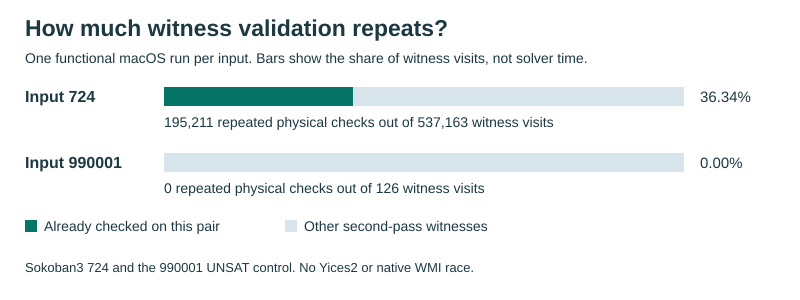

# Does Viper validate the same witness twice?

On Sokoban3 724, **195,211 of 537,163 second-pass witness visits (36.34%)** repeated a physical check that had already succeeded for the same directed root pair within one immutable traversal. On the UNSAT control, none of 126 visits repeated it. These are counts from one macOS arm64 functional run per input, **not a solver speedup**.



| Input | Answer | Root checks (fixed / post-fixed) | Duplicates (fixed / post-fixed) | Second-pass witness visits |
|---|---|---:|---:|---:|
| Sokoban3 724 | SAT | 8,013 / 16,808 | 4 / 195,207 | 537,163 |
| 990001 control | UNSAT | 94 / 4 | 0 / 0 | 126 |

The solver stores some disequalities explicitly and represents others by a compact group of pairwise-distinct terms. When a root is audited with both representations live, the physical witness lookup validates its stored IDs. The enclosing traversal may then validate the same IDs again. The observer matches those two successful checks by directed root pair and witness ID under the same immutable borrow. It does not count virtual witnesses as duplicates. The 341,952 other second-pass visits on 724 were virtual. The alternative of reusing a root audit *within one impact calculation* had only five repeated visits out of 13 on 724, at a different call site.

## Replay from a clone

Run from this directory. Evidence replay uses only the Python 3 standard library and never launches a solver:

```sh
shasum -a 256 -c SHA256SUMS
python3 -B verify.py
python3 -B -m unittest discover -s . -p 'test_replay.py'
cargo test --locked --manifest-path native/Cargo.toml single_audit_ -- --test-threads=1
```

The first command checks the original inputs, the two pairs of stdout/stderr streams, the two PID-bound audit packets, the 724 member catalogue, and the [committed dashboard](../../../status/euf-single-audit-host-2026-11-10.json). It derives the counts, rather than reading them from the chart. The second exercises rejection paths. The third compiles and exercises the [isolated native observer](native/README.md); it is not a second full solver run.

## What is published

- [Run metadata](runs.json) is an allowlisted projection of the host receipt. It keeps source and executable hashes, role flags, PIDs and artifact hashes. The checkout-dependent input path is relative here. The original private receipt digest identifies provenance; it is not a claim that the unredacted receipt can be reconstructed.
- [Raw packets](raw), [original inputs](inputs), [724 catalogue](members-724.json), and the chart retain their recorded bytes. [Input attribution](inputs/README.md) identifies the origin and license of the external benchmark.
- [Full observer patch](observer.patch) is the unmodified Git diff from historical parent `22c88b8677c2f790d4d1bbb1ab419cff58bbb529` to probe `967d4d0bce9cb55a9b889e2cda5e8619ff512810`. It includes registration, fixed-root and terminal hooks, along with the counter and regression tests. It is **not** a patch against the older GitHub solver tip. Applying it to the exact historical parent reproduced Git tree `d279a16f9b2f51276b4030820bab19c202289f83`. The historical full solver checkout and executable are not part of this release.
- The measured executable was a Rust 1.93.0, optimization-level-0 build on Apple Silicon. Neither Yices2 nor another competitor was rerun. No production source or default on this branch is changed.

## Decision

Test one-pass validation first: reuse the physical check under the immutable borrow, without dropping virtual-witness, ordering, reverse-adjacency or source-reason checks. The registered WMI study requires eight matched blocks per input with release, inactive and active observer arms. The one-pass candidate requires at least 10,000 duplicate visits and a 10% share on 724, with valid and stable captures on both inputs. The two host runs do **not** open that gate. The follow-up WMI build, scout and quiet race have not run in this study; there is no new ranking against Yices2 or Z3.
